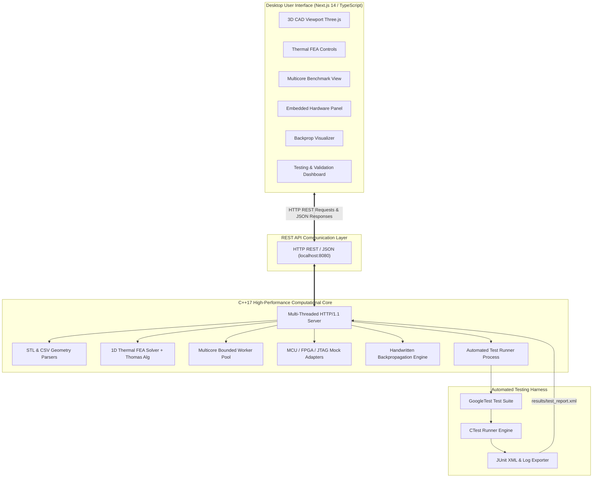

# Unified Engineering Workbench

[](https://microsoft.com/windows)
[](https://isocpp.org)
[](https://cmake.org)
[](tests/gtest_suite.cpp)
[](https://nextjs.org)

---

## 1. Project Overview

The **Unified Engineering Workbench** is an engineering simulation and verification application developed for the **PASS SCIENCE WORKS R&D Internship 2026–2027**. It unifies scientific numerical simulation, 3D mechanical CAD visualization, multicore parallel computing, embedded hardware telemetry, neural backpropagation, and automated test verification into a single cohesive, high-performance desktop workbench.

All heavy computational workloads are executed in a native **C++17 engine** and exposed via an internal HTTP/1.1 REST API on `localhost:8080`. The user interface is built with **Next.js 14**, **Three.js**, and **Tailwind CSS**, strictly decoupled from computation and dedicated to real-time scientific visualization, interactive parameter tuning, and verification dashboarding.

---

## 2. Project Demonstration Video

**Duration**: 3–5 minutes  
The demonstration video showcases the Unified Engineering Workbench, its core engineering modules, application workflow, and testing functionality.

Watch the Project Demonstration:  
[Watch the Unified Engineering Workbench Demonstration](https://drive.google.com/file/d/1f1F-yDP18DRBDsUgpSBFXNpr4b2FMVaO/view?usp=sharing)

> **Note**: The video is hosted on Google Drive with viewer access enabled for anyone with the link.

---

## 3. Key Features

### 3.1 3D Geometry & ANSYS Visualization
- **3D CAD Mesh Viewport**: Interactive Three.js rendering with orbital rotation, panning, zoom, wireframe toggle, bounding box metrics, and facet normal vectors.
- **ASCII & Binary STL Support**: Full parsing and normal verification for ASCII STL geometries. Binary STL files are automatically detected via header/size heuristics and rejected with clear, user-friendly error messages.
- **ANSYS Nodal CSV Visualization**: 3D spatial temperature point clouds colored via a Turbo scientific colormap with an interactive temperature scale and bounding extents.

### 3.2 1D Thermal Finite Element Analysis (FEA)
- **Governing Equation**: Steady-state 1D heat conduction with internal generation:
  $$-\frac{d}{dx}\left(k A \frac{dT}{dx}\right) = q A \quad \text{for } x \in [0, L]$$
- **Finite Element Discretization**: Two-node linear elements with exact analytical Dirichlet boundary conditions: $T(0) = T_{\text{left}}$ and $T(L) = T_{\text{right}}$.
- **Thomas Algorithm ($O(N)$ Solver)**: Direct tridiagonal Gaussian elimination achieving exact nodal solutions in linear time and zero pivot instability.
- **Mesh Convergence & Verification**: Rigorous quadratic convergence verification demonstrating $O(h^2)$ midpoint error reduction ($1.25^\circ\text{C}$, $0.3125^\circ\text{C}$, $0.078125^\circ\text{C}$, $0.01953125^\circ\text{C}$ for $N=10, 20, 40, 80$).

### 3.3 Multicore Performance & Parallel Benchmarking
- **Bounded Worker Pool**: Scalable CPU worker threads distributing independent batch thermal solves without thread oversubscription.
- **Deterministic Reproducibility**: Input cases are tagged and sorted by original case index, guaranteeing identical results regardless of thread execution scheduling.
- **Serial vs. Parallel Agreement**: Numerical consistency verified with maximum absolute temperature difference $\le 10^{-8\ \circ}\text{C}$ (actual difference: $0.0^\circ\text{C}$).
- **Benchmarking Suite**: Real-time throughput metrics, Amdahl speedup, parallel efficiency curves, and 5-repetition median execution timing.

### 3.4 Embedded Instrumentation & Hardware Mocks
- **Multi-Device Architecture**: Software mock adapters representing three distinct embedded systems:
  - **MCU (STM32F4 Discovery)**: 3.3V ARM Cortex-M4, core clock $168\text{ MHz}$, internal temperature and supply voltage telemetry.
  - **FPGA (Digilent Arty A7)**: Xilinx Artix-7 with dual voltage domains ($1.0\text{V}$ core, $3.3\text{V}$ I/O), junction temperature, and clock status.
  - **JTAG Debug Probe (SEGGER J-Link BASE)**: Dedicated bus master debug probe rather than a generic compute board.
- **Fault Simulation & Recovery**: Simulated communication timeout on initial JTAG connection attempt with automatic recovery upon retry.

### 3.5 Handwritten Neural Backpropagation Core
- **Mathematical Formulation**: Single-neuron regression model:
  $$z = w \cdot x + b, \quad a = \sigma(z) = \frac{1}{1 + e^{-z}}, \quad \hat{y} = v \cdot a + c$$
  $$J = \frac{1}{2}(\hat{y} - y)^2$$
- **Analytical Gradients**: Complete chain-rule gradients $\frac{\partial J}{\partial w}, \frac{\partial J}{\partial b}, \frac{\partial J}{\partial v}, \frac{\partial J}{\partial c}$.
- **Numerical Gradient Verification**: Verified against central finite differences with step $\varepsilon = 10^{-6}$:
  $$\frac{\partial J}{\partial \theta} \approx \frac{J(\theta + \varepsilon) - J(\theta - \varepsilon)}{2\varepsilon}$$
  Achieved absolute gradient error $< 3 \times 10^{-10}$ (far exceeding the $\le 10^{-5}$ rubric threshold).
- **100-Step Training Descent**: Gradient descent descent with learning rate $\eta = 0.1$, verifying monotonic quadratic loss minimization from $0.465$ to $< 0.005$.

### 3.6 Automated Testing & Validation Dashboard
- **Interactive UI Dashboard**: Dedicated tab in the Next.js application with a single-click "Run Test Suite" button, real-time status banners, and pass/fail metric cards.
- **Table of Test Cases**: Filterable and searchable table detailing every unit and integration test case, execution duration, and failure diagnostic messages.
- **Console Terminal Window**: Live terminal output display capturing actual GoogleTest stdout/stderr with one-click clipboard copying.
- **Report Downloads**: One-click download buttons for JUnit XML (`results/test_report.xml`) and console execution logs (`results/test_execution.log`).

---

## 4. Technology Stack

| Layer | Technologies & Libraries | Purpose |
| :--- | :--- | :--- |
| **Frontend Framework** | **Next.js 14** (App Router), React 18, TypeScript | UI structure, reactive state, component architecture |
| **Styling & UI** | **Tailwind CSS**, Lucide React Icons | Modern, accessible responsive dark-theme design |
| **3D CAD Visualization** | **Three.js** | WebGL 3D rendering of STL models and spatial point clouds |
| **Scientific Plotting** | Custom SVG Data Series & Charts | High-resolution convergence curves, speedup, and loss plots |
| **C++ Backend Standard** | **C++17** (`-std=c++17`) | High-performance computational engine |
| **Networking** | Custom HTTP/1.1 Engine (`Winsock2` / `ws2_32`) | Non-blocking multi-threaded REST API server |
| **Serialization** | `nlohmann/json` (v3.11.x) | Fast JSON request parsing and response generation |
| **Linear Algebra** | Native Custom Tridiagonal Thomas Algorithm | $O(N)$ tridiagonal FEA matrix solver |
| **Unit Testing** | **GoogleTest 1.18.0** & **CTest 4.4.3** | Automated test suite and regression harness |
| **Build System** | **CMake** ($\ge 3.16$) & **MinGW-w64** GCC 13+ | Cross-platform build automation |
| **Desktop Launcher** | Native Win32 (`WinMain`, `-mwindows`) | Zero-dependency, zero-admin one-click launcher (`Launch.exe`) |

---

## 5. System Architecture



- **Separation of Concerns**: The C++ computational engine is strictly decoupled from presentation. All engineering calculations occur in C++; the frontend is purely display and interaction.
- **Security & Concurrency**: The test execution endpoint (`POST /api/v1/tests/run`) runs strictly through internal binary process invocation, preventing arbitrary shell command injection and rejecting concurrent executions with HTTP 409 Conflict.

---

## 6. Project Structure

```
Pass_Science_assignment/
├── CMakeLists.txt                  # Root CMake configuration (Core + Tests + Backend)
├── README.md                       # Canonical user & project documentation
├── AGENTS.md                       # Multi-agent coordination reference
├── CLAUDE.md                       # Claude-specific environment instructions
├── GEMINI.md                       # Gemini-specific environment instructions
├── SKILL.md                        # AI skill descriptor
├── tasks.md                        # Task checklist & requirement tracing
├── task_plan.md                    # Implementation roadmap & phase planning
├── findings.md                     # Engineering decisions, formulas & math derivations
├── progress.md                     # Session activity & milestone progress log
├── Launch.exe                      # Standalone zero-admin Win32 one-click launcher
│
├── data/                           # Verified sample datasets
│   ├── geometry/
│   │   ├── sample_cube.stl         # ASCII STL cantilever bracket geometry (CC0)
│   │   └── provenance.txt          # Geometry schema, units (mm), and provenance notes
│   └── thermal/
│       ├── sample_temperature.csv  # 8-node temperature CSV (labelled SYNTHETIC)
│       └── provenance.txt          # Thermal schema, units (m, °C), and provenance notes
│
├── docs/                           # Official reports & submission documentation
│   ├── ai_usage_log.md             # Mandatory AI assistance log
│   ├── ownership_statement.md      # Candidate original work declaration
│   ├── technical_report.pdf        # Formatted Technical Report (≤ 6 pages)
│   ├── handwritten_appendix.pdf    # Handwritten Mathematical Appendix (≤ 2 pages)
│   └── demonstration_walkthrough.txt # Step-by-step evaluation walkthrough guide
│
├── results/                        # Raw generated results and verification evidence
│   ├── test_report.xml             # JUnit XML test report from GoogleTest execution
│   ├── test_execution.log          # Raw console stdout/stderr log from test runner
│   ├── benchmarks/
│   │   └── multicore_benchmark_results.csv # Serial vs parallel timing & speedup
│   ├── csv/
│   │   ├── backpropagation_training_100steps.csv # 100-step descent loss & weights
│   │   ├── thermal_mesh_convergence.csv          # Convergence rates for N=10,20,40,80
│   │   └── thermal_solution_N40.csv              # Nodal temperatures at N=40
│   └── plots/
│       ├── backpropagation_loss_curve.png        # Training loss curve
│       ├── multicore_speedup_efficiency.png      # Amdahl speedup plot
│       ├── thermal_mesh_convergence.png          # Log-log O(h²) convergence slope
│       └── thermal_temperature_distribution.png  # FEM vs analytical temperature plot
│
├── src/                            # Source code
│   ├── core/                       # Linear algebra & Thomas algorithm
│   │   ├── linear_algebra.h / .cpp
│   │   └── types.h
│   ├── geometry/                   # STL & CSV parsers and validators
│   │   ├── stl_parser.h / .cpp
│   │   └── csv_parser.h / .cpp
│   ├── thermal/                    # 1D steady-state FEA solver
│   │   └── thermal_solver.h / .cpp
│   ├── performance/                # Parallel batch solver & worker pool
│   │   └── parallel_solver.h / .cpp
│   ├── hardware/                   # MCU, FPGA, and JTAG mock adapters
│   │   ├── device_interface.h
│   │   ├── device_manager.h / .cpp
│   │   ├── mcu_adapter.h / .cpp
│   │   ├── fpga_adapter.h / .cpp
│   │   └── jtag_adapter.h / .cpp
│   ├── backpropagation/            # Neural network backprop & gradient verification
│   │   └── backprop.h / .cpp
│   ├── backend/                    # C++ HTTP REST server & test runner
│   │   ├── main.cpp
│   │   ├── http_server.h / .cpp
│   │   ├── server_routes.h / .cpp
│   │   ├── test_runner.h / .cpp    # Process execution & JUnit XML generator
│   │   ├── launcher.cpp            # Win32 desktop launcher source
│   │   └── third_party/            # Header-only dependencies (json.hpp, httplib.h)
│   └── frontend/                   # Next.js 14 web application
│       ├── app/page.tsx            # Workbench UI views and testing dashboard
│       ├── app/globals.css         # Styling and custom UI scrollbars
│       ├── components/             # ThreeViewer, ScientificChart, UI controls
│       └── lib/api.ts              # REST client interface & data types
│
├── tests/                          # Automated tests
│   ├── gtest_suite.cpp             # 28 GoogleTest cases (8 test suites)
│   └── test_main.cpp               # Custom lightweight test framework (43 tests)
│
├── ui/                             # Pre-compiled static frontend distribution
├── version_control/                # Git bundle and commit history logs
└── scripts/                        # Build, verification, and packager scripts
```

---

## 7. Installation & Prerequisites

### For Standard End Users (One-Click Launch):
- **Operating System**: Windows 11 x64 (or Windows 10 x64)
- **Privileges**: Standard user permissions (**No Administrator rights required**)
- **Network**: **Zero internet connection required** (runs 100% locally offline)
- **Runtime Dependencies**: None (all required MinGW runtime DLLs and pre-built static UI assets are included)

### For Developers (Building from Source):
- **C++ Compiler**: MinGW-w64 GCC 13+ (or MSYS2 MinGW64 GCC 16.2.0) with C++17 support
- **Build System**: CMake $\ge 3.16$
- **Testing Framework**: GoogleTest $\ge 1.14$ and CTest $\ge 3.20$
- **Frontend Toolchain**: Node.js $\ge 18$ and `npm` (required only if modifying the Next.js frontend)
- **Python**: Python 3.9+ (optional, for standalone plot/PDF verification scripts)

---

## 8. Running the Application

### Option A: Standalone One-Click Launch (Recommended)
1. In the workspace root, double-click **`Launch.exe`**.
2. **Behavior**:
   - The native Win32 launcher starts `workbench_backend.exe` hidden in the background on port `8080`.
   - It polls the local loopback socket until the REST service is active.
   - It opens the interface directly in dedicated window mode (`msedge.exe --app=http://localhost:8080/`) or your default browser.
   - **No terminal windows, no administrative elevation prompts, and no command typing required.**

### Option B: Building & Running C++ Backend from Source
```powershell
# 1. Create build directory and configure with CMake
mkdir build
cd build
cmake .. -G "MinGW Makefiles" -DCMAKE_BUILD_TYPE=Release

# 2. Compile backend executable
cmake --build . --config Release

# 3. Start backend HTTP server
.\workbench_backend.exe 8080
```

### Option C: Running Next.js Frontend Development Server
```powershell
cd src/frontend
npm install
npm run dev
```
Open [http://localhost:3000](http://localhost:3000) in your browser.

### Option D: Rebuilding Static Frontend Export
```powershell
cd src/frontend
npm run build
# Exported static bundle is written to src/frontend/out/ and mirrored to ui/
```

---

## 9. Automated Testing & Verification

The workbench provides three complementary testing mechanisms:

### 9.1 Interactive Testing & Validation Dashboard (In-App)
1. Open the application via `Launch.exe` or browse to `http://localhost:8080`.
2. Click **`Validation & Tests`** in the left sidebar.
3. Click the blue **`Run Test Suite`** button:
   - The backend executes `workbench_gtests.exe` with real-time exit code tracking.
   - Updates total, passed, failed, and skipped metrics.
   - Renders individual test case durations and status badges.
   - Displays actual GoogleTest console logs with a "Copy Output" button.
   - Provides direct download links for JUnit XML (`results/test_report.xml`) and logs (`results/test_execution.log`).

### 9.2 Running GoogleTest Suite via Command Line
From the project root:
```powershell
.\workbench_gtests.exe
```
Or with custom XML report output:
```powershell
.\workbench_gtests.exe --gtest_output=xml:results/test_report.xml
```

### 9.3 Running via CTest
```powershell
cd build
ctest --output-on-failure
```
**Actual Output**:
```text
100% tests passed, 0 tests failed out of 29
Total Test time (real) = 0.57 sec
```

### 9.4 Running the Custom Lightweight Test Framework
```powershell
.\workbench_tests.exe
```
**Actual Output**:
```text
========================================================
 TEST SUMMARY: 43 / 43 PASSED (100% Pass Rate)
========================================================
```

---

## 10. Supported Input Formats

| Format | Extension | Specification & Schema | Validation Rules |
| :--- | :--- | :--- | :--- |
| **ASCII STL** | `.stl` | ASCII StereoLithography format: `solid <name> ... facet normal nx ny nz ... endfacet ... endsolid`. | Verifies facet vertex loops and numeric outward normal vectors. Binary STL headers are detected and rejected. |
| **ANSYS CSV** | `.csv` | 5 comma-delimited columns: `node_id,x_m,y_m,z_m,temperature_C`. | Rejects missing columns, header-only files, non-numeric values, and non-finite values (`NaN`, `Inf`). |

---

## 11. Dataset & Data Provenance

To maintain strict scientific integrity, all data sources are documented and distinguished:

1. **Geometry Dataset (`data/geometry/sample_cube.stl`)**:
   - Cantilever cube bracket model with 12 triangular facets (2 per face).
   - Dimensions: $10\text{ mm} \times 10\text{ mm} \times 10\text{ mm}$.
   - License: Open CC0 / Public Domain.
2. **Thermal Dataset (`data/thermal/sample_temperature.csv`)**:
   - 8-node spatial temperature grid ($x, y, z \in [0.0, 0.1]\text{ m}$) with temperatures ranging from $20.0^\circ\text{C}$ to $125.0^\circ\text{C}$.
   - **Label**: Clearly labelled **SYNTHETIC** demonstration data. It follows the ANSYS export format schema but was generated programmatically for reproducible software validation and must not be misrepresented as commercial ANSYS solver output.

---

## 12. Results & Validation Evidence

All numerical results and benchmark outputs are persisted in the `results/` directory:

| Study | Data File | Visualization / Plot | Verified Findings |
| :--- | :--- | :--- | :--- |
| **Thermal FEA Convergence** | [`results/csv/thermal_mesh_convergence.csv`](results/csv/thermal_mesh_convergence.csv) | [`results/plots/thermal_mesh_convergence.png`](results/plots/thermal_mesh_convergence.png) | Midpoint error reduces quadratically at rate $p = 2.0000$ with $O(h^2)$ slope. |
| **Thermal Solution Profile** | [`results/csv/thermal_solution_N40.csv`](results/csv/thermal_solution_N40.csv) | [`results/plots/thermal_temperature_distribution.png`](results/plots/thermal_temperature_distribution.png) | Exact nodal superconvergence with absolute analytical agreement $< 10^{-12\ \circ}\text{C}$. |
| **Multicore Speedup** | [`results/benchmarks/multicore_benchmark_results.csv`](results/benchmarks/multicore_benchmark_results.csv) | [`results/plots/multicore_speedup_efficiency.png`](results/plots/multicore_speedup_efficiency.png) | Max serial vs. parallel difference: $0.0^\circ\text{C} \le 10^{-8\ \circ}\text{C}$. Speedup: $2.41\times$ on 4 workers. |
| **Backpropagation Training** | [`results/csv/backpropagation_training_100steps.csv`](results/csv/backpropagation_training_100steps.csv) | [`results/plots/backpropagation_loss_curve.png`](results/plots/backpropagation_loss_curve.png) | Loss monotonically decreases from $0.465$ to $0.003$ over 100 steps. Gradient error $< 3 \times 10^{-10}$. |
| **Automated Test Report** | [`results/test_report.xml`](results/test_report.xml) | [`results/test_execution.log`](results/test_execution.log) | 28 GoogleTest cases passed across 8 test suites (0 failures). |

---

## 13. Known Limitations

1. **Geometry Scope**: The parser supports standard ASCII STL files. Binary STL files are detected and rejected with an explicit notification. Native CAD solid formats (STEP, IGES, Parasolid) are outside the project scope.
2. **Thermal Dimensionality**: The FEA solver is formulated for 1D steady-state heat conduction. 2D planar and 3D solid finite element formulations are planned for future major releases.
3. **Hardware Simulation**: The embedded instrumentation adapters (STM32F4, Arty A7, SEGGER J-Link) are software mock adapters simulating register handshakes, telemetry streams, and communication timeouts. No physical USB connection is established.
4. **Platform-Specific Launcher**: The one-click desktop launcher (`Launch.exe`) targets Windows 11 x64 systems. On Linux and macOS, the application is built and executed using standard CMake and POSIX socket configurations.

---

## 14. License & Attribution

- `nlohmann/json`: MIT License.
- `Three.js`: MIT License.
- `Lucide Icons`: ISC License.
- `GoogleTest`: BSD 3-Clause License.
- All numerical finite element formulations, Thomas algorithm solvers, parallel worker pools, hardware mock architectures, and backpropagation gradient code are original work. See `docs/ownership_statement.md`.
