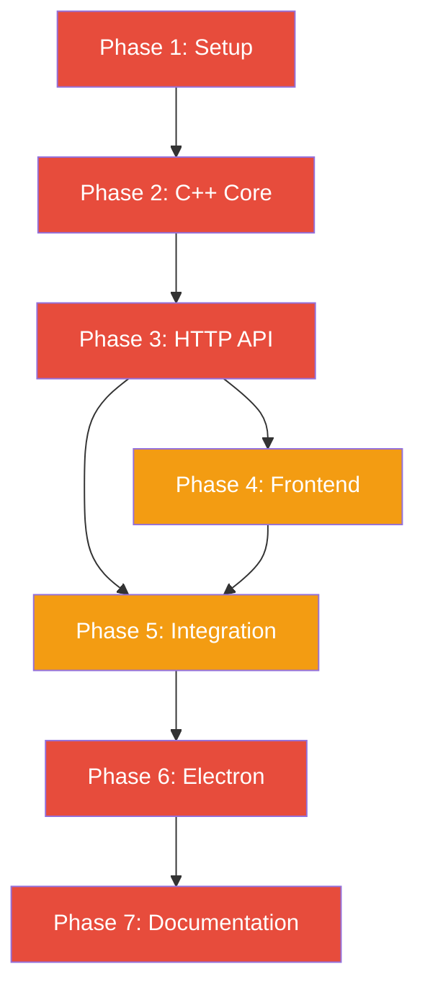

# task_plan.md — Implementation Strategy

> Phased plan for building the PASS SCIENCE WORKS Unified Engineering Workbench.
> See [tasks.md](./tasks.md) for the full checklist and [AGENTS.md](./AGENTS.md) for architecture.

---

## Priority Order (Shortlisting Gates First)

The assignment has three **shortlisting gates** that must be passed or the submission
is automatically rejected:

1. **C++ backend** ≥ 6/12 points
2. **Thermal FEA** ≥ 7/14 points
3. **Delivery/report** ≥ 3/6 points

Plus: the C++ backend must compile and `Launch.exe` must run standalone.

**Strategy**: Build the core C++ computation first (Phases 1–3), then frontend
(Phase 4), then polish and package (Phases 5–7).

---

## Phase 1: Project Setup & Architecture

**Duration**: ~1 day  
**Priority**: 🔴 Critical  
**Depends on**: Nothing

### Objectives

- Set up the complete directory structure.
- Initialize Git repository with `.gitignore`.
- Set up CMake build system for C++ backend.
- Install and verify C++ compiler (MSYS2 GCC 13+ or MSVC).
- Install third-party headers (cpp-httplib, nlohmann/json, Eigen, spdlog).
- Initialize Next.js frontend project.
- Create all documentation scaffolds.

### Files Created

```
CMakeLists.txt (root and src/backend/)
.gitignore
src/core/types.h, error.h, utils.h
src/backend/third_party/ (httplib.h, json.hpp, eigen/)
src/backend/tests/test_framework.h
src/frontend/package.json (npm init)
```

### Verification

- [ ] `cmake --build .` compiles a minimal main.cpp
- [ ] Frontend `npm run dev` starts without errors
- [ ] Git repo initialized with first commit

---

## Phase 2: Core C++ Backend

**Duration**: ~4 days  
**Priority**: 🔴 Critical (shortlisting gates)  
**Depends on**: Phase 1

### 2A — Thermal FEA Solver (~2 days)

**Files**:
- `src/thermal/element.h / .cpp` — Element stiffness matrix and load vector
- `src/thermal/mesh.h / .cpp` — Mesh generation and global assembly
- `src/thermal/solver.h / .cpp` — Dirichlet BC application and direct solve
- `src/thermal/analytical.h / .cpp` — Analytical solution for verification
- `src/backend/tests/test_thermal.cpp` — Comprehensive tests

**Implementation Details**:

1. **Element stiffness matrix** (2×2):
   ```
   k_e = (kA / L_e) * [ 1, -1;
                        -1,  1]
   ```
   where k = thermal conductivity, A = cross-section area, L_e = element length.

2. **Element load vector** (2×1):
   ```
   f_e = (q * A * L_e / 2) * [1; 1]
   ```
   where q = volumetric heat source.

3. **Global assembly**: Loop over elements, scatter element matrices into global K and F.

4. **Dirichlet BCs**: Modify global system for T(0) = 100°C, T(L) = 20°C.

5. **Solve**: Use Eigen's `ColPivHouseholderQR` or `SimplicialLDLT`.

6. **Analytical solution**: `T_exact(x) = 100 - 80x/L + [q/(2k)]·x·(L - x)`

7. **Verification**: Solve for N = 10, 20, 40, 80. Compute max error at element midpoints.

**Testing**:
- Single element problem with known solution
- Multi-element against analytical
- Boundary condition verification
- Convergence rate check (error should decrease as O(h²))

### 2B — Geometry Parsers (~1 day)

**Files**:
- `src/geometry/stl_parser.h / .cpp` — ASCII STL parsing
- `src/geometry/csv_parser.h / .cpp` — ANSYS CSV temperature parsing
- `src/geometry/validators.h / .cpp` — Input validation
- `src/backend/tests/test_stl_parser.cpp`
- `src/backend/tests/test_csv_parser.cpp`
- `data/example.stl` — Example STL with provenance
- `data/example_temperature.csv` — SYNTHETIC CSV

**STL Parser Requirements**:
- Parse ASCII STL format: `solid`, `facet normal`, `outer loop`, `vertex`, `endloop`, `endfacet`, `endsolid`
- Extract vertices and facet normals
- Validate: proper structure, finite coordinates, consistent normals
- Reject binary STL (detect by checking for `solid` keyword)
- Report parse errors with line numbers

**CSV Parser Requirements**:
- Required columns: `X`, `Y`, `Z`, `Temperature`
- Validate: columns present, values are finite numbers, file not empty
- Handle quoted fields and different delimiters
- Report row-level validation errors

### 2C — Backpropagation (~0.5 days)

**Files**:
- `src/backpropagation/network.h / .cpp` — Forward pass and manual backprop
- `src/backpropagation/gradient_check.h / .cpp` — Central finite differences
- `src/backpropagation/training.h / .cpp` — Training loop
- `src/backend/tests/test_backprop.cpp`

**Network Architecture** (from assignment):
- Input: x (scalar)
- Hidden: h = σ(w·x + b) with sigmoid activation
- Output: ŷ = v·h + c
- Loss: L = (ŷ - y)²

**Gradients** (chain rule):
```
∂L/∂c = 2(ŷ - y)
∂L/∂v = 2(ŷ - y) · h
∂L/∂b = 2(ŷ - y) · v · σ'(w·x + b)
∂L/∂w = 2(ŷ - y) · v · σ'(w·x + b) · x
```
where σ'(z) = σ(z)(1 - σ(z))

**Key requirement**: Update all parameters simultaneously from ORIGINAL values (not sequentially).

### 2D — Parallel Batch Solver (~0.5 days)

**Files**:
- `src/performance/batch_runner.h / .cpp`
- `src/performance/worker_pool.h / .cpp`
- `src/performance/benchmark.h / .cpp`

**Requirements**:
- Thread pool with configurable worker count
- Fixed-seed random case generator (deterministic)
- Results ordered by input case index
- Serial baseline implementation
- Wall-clock timing (exclude I/O)
- Serial/parallel agreement ≤ 1e-8 °C

### 2E — Hardware Mock Adapters (~0.5 days)

**Files**:
- `src/hardware/device_types.h`
- `src/hardware/mcu_adapter.h / .cpp`
- `src/hardware/fpga_adapter.h / .cpp`
- `src/hardware/jtag_adapter.h / .cpp`
- `src/hardware/device_manager.h / .cpp`

**Requirements**:
- Common interface: `discover()`, `get_capabilities()`, `connect()`, `disconnect()`, `get_telemetry()`
- MCU: simulates temperature sensor, GPIO, ADC
- FPGA: simulates configuration, logic utilization, I/O pins
- JTAG: simulates debug chain, boundary scan, TAP controller
- Failure modes: connection timeout, communication error → recovery
- All marked `SIMULATED`

---

## Phase 3: C++ HTTP API Server

**Duration**: ~1 day  
**Priority**: 🔴 Critical  
**Depends on**: Phase 2

### Files

- `src/backend/main.cpp` — Entry point, starts HTTP server
- `src/backend/server.h / .cpp` — Server setup, CORS, middleware
- `src/backend/routes/geometry_routes.h / .cpp`
- `src/backend/routes/thermal_routes.h / .cpp`
- `src/backend/routes/performance_routes.h / .cpp`
- `src/backend/routes/hardware_routes.h / .cpp`
- `src/backend/routes/backprop_routes.h / .cpp`

### API Endpoints

| Method | Path | Description |
|--------|------|-------------|
| `POST` | `/api/geometry/stl/parse` | Upload and parse STL file |
| `POST` | `/api/geometry/csv/parse` | Upload and parse CSV file |
| `POST` | `/api/thermal/solve` | Run thermal FEA solver |
| `GET`  | `/api/thermal/analytical` | Get analytical solution |
| `POST` | `/api/performance/batch` | Run parallel batch |
| `GET`  | `/api/performance/benchmark` | Run benchmark suite |
| `GET`  | `/api/hardware/devices` | List all devices |
| `POST` | `/api/hardware/connect` | Connect to device |
| `POST` | `/api/hardware/disconnect` | Disconnect device |
| `GET`  | `/api/hardware/telemetry` | Get device telemetry |
| `POST` | `/api/backprop/train` | Train neural network |
| `POST` | `/api/backprop/verify` | Run gradient check |
| `GET`  | `/api/health` | Server health check |

### Verification

- [ ] Server starts and responds to `/api/health`
- [ ] All routes return proper JSON
- [ ] CORS headers set for frontend origin
- [ ] Error responses use consistent format: `{"error": "message", "code": 400}`

---

## Phase 4: Frontend Views

**Duration**: ~3 days  
**Priority**: 🟡 High  
**Depends on**: Phase 3

### 4A — Project Setup & Layout (~0.5 days)

- Initialize Next.js with TypeScript, Tailwind, shadcn/ui
- Create app layout with sidebar navigation (4 views)
- Set up API client (`lib/api.ts`)
- Configure Three.js/R3F and Plotly

### 4B — Geometry View (~1 day)

- STL file upload and 3D viewer (Three.js/R3F)
  - Rotate, pan, zoom, fit-to-view controls
- CSV file upload and temperature point cloud
  - Color-mapped points by temperature
  - Temperature legend with units
  - Node inspection on hover/click

### 4C — Thermal Analysis View (~0.5 days)

- Parameter input form (k, q, L, T_left, T_right, mesh sizes)
- Solve button with progress indicator
- Temperature vs x plot (Plotly, all mesh sizes overlaid)
- Convergence plot (N vs max error, log scale)
- Results table and CSV export

### 4D — Performance View (~0.5 days)

- Batch configuration (case count, mesh size, worker counts)
- Run benchmark button
- Speedup chart (workers vs speedup)
- Efficiency table
- System info display

### 4E — Hardware View (~0.5 days)

- Device cards for MCU, FPGA, JTAG
- Connect/disconnect buttons
- Telemetry displays
- Block diagram visualization
- Failure recovery demonstration

---

## Phase 5: Integration & Testing

**Duration**: ~1.5 days  
**Priority**: 🟡 High  
**Depends on**: Phases 3–4

### Tasks

- End-to-end testing: frontend → API → backend → response → display
- Error handling: network failures, invalid inputs, server crashes
- Performance: ensure UI stays responsive during computation
- Cross-module testing: thermal solver results displayed correctly
- File size limits enforced
- Cancellation / safe completion
- All C++ tests green
- Frontend builds without warnings

---

## Phase 6: Electron Packaging & Launch.exe

**Duration**: ~1 day  
**Priority**: 🔴 Critical (shortlisting gate)  
**Depends on**: Phase 5

### Tasks

- Configure Electron main process (`electron/main.ts`)
  - Spawn C++ backend as child process
  - Wait for backend health check
  - Load frontend in BrowserWindow
  - Kill backend on exit
- electron-builder configuration in `package.json`
- Build for Windows x64 (`npm run electron-build`)
- Test `Launch.exe` on clean Windows 11 machine
- Verify: no terminal, no admin, no install required
- Bundle all dependencies (C++ binary, Node.js runtime, frontend assets)

---

## Phase 7: Documentation & Delivery

**Duration**: ~1.5 days  
**Priority**: 🔴 Critical (shortlisting gate)  
**Depends on**: Phase 6

### Tasks

- Finalize `README.md` with accurate build and run instructions
- Write technical report (≤ 6 pages PDF)
  - Architecture overview
  - Implementation highlights
  - Test results and verification
  - Limitations and future work
- Create demo video OR timestamped screenshots with log output
- Complete `docs/ai_usage_log.md`
- Write `docs/ownership_statement.md`
- Review all tasks.md items
- Create Git bundle with meaningful commit history
- Package `CandidateID_Workbench.zip`
- Final verification: extract ZIP on clean machine, run Launch.exe

---

## Dependency Graph



---

## Time Estimate Summary

| Phase | Duration | Cumulative |
|-------|----------|------------|
| Phase 1: Setup | 1 day | Day 1 |
| Phase 2: C++ Core | 4 days | Day 5 |
| Phase 3: HTTP API | 1 day | Day 6 |
| Phase 4: Frontend | 3 days | Day 9 |
| Phase 5: Integration | 1.5 days | Day 10.5 |
| Phase 6: Electron | 1 day | Day 11.5 |
| Phase 7: Documentation | 1.5 days | Day 13 |
| **Buffer** | **2 days** | **Day 15** |

---

## Risk Mitigation

| Risk | Likelihood | Impact | Mitigation |
|------|-----------|--------|------------|
| Compiler issues (MinGW C++17) | Medium | High | Use MSYS2 with GCC 13+ or switch to MSVC |
| Electron bundling complexity | Medium | High | Test packaging early; have fallback script launcher |
| Thermal solver bugs | Low | Critical | Extensive testing against analytical solution |
| Three.js performance with large STL | Medium | Medium | Implement file size limits; simplify meshes |
| Time overrun | Medium | High | Focus on shortlisting gates first; defer polish |
